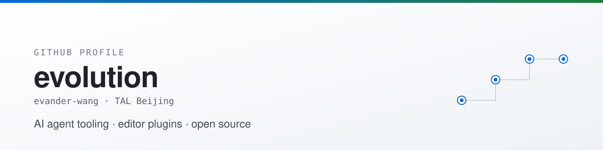
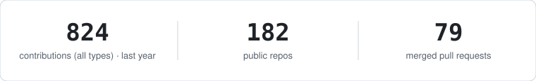

<picture>
  <source media="(prefers-color-scheme: dark)" srcset="./assets/banner-dark.svg">
  
</picture>

  
  
  
  
  
  
  

  <picture>
    <source media="(prefers-color-scheme: dark)" srcset="./assets/activity-dark.svg">
    
  </picture>

---

### What I'm working on

- **tour-spec** — one tour spec, two consumers: a step-through call-chain walkthrough in Neovim (numbered stations, quickfix index, why-bar) and a self-contained HTML code map. Includes anchor-based self-healing plus `check` / `sync`.
- **pi plugins** — `pi-next-steps` (three next-step candidates after every turn, one keystroke to insert), `pi-token-speed` (live token rate in the status line), `pi-extensions` (plugin scaffold).
- **Upstream fixes in [GitNexus](https://github.com/abhigyanpatwari/GitNexus)** — Go language provider type inference, storage-layer crash recovery, web interaction.
- Reading Go and TypeScript codebases by drawing the call chain first, then changing one line.

---

### Projects I maintain

<table>
<tr>
<td width="50%" valign="top">

**[tour-spec](https://github.com/evander-wang/tour-spec)** · Lua
A spec says how a call chain is cut into stations, where each one lives, and why you walk there. Rendered into Neovim and into an HTML code map from the same file.

</td>
<td width="50%" valign="top">

**[pi-next-steps](https://github.com/evander-wang/pi-next-steps)** · TypeScript
Proposes up to three next steps after every turn: fill one into the editor, or hand any of them to a fresh agent in a new pane.

</td>
</tr>
<tr>
<td width="50%" valign="top">

**[pi-token-speed](https://github.com/evander-wang/pi-token-speed)** · TypeScript
Live output token rate in the pi status bar. Sliding 3-second window, stall/burst correction (a 500-token flush after a 6 s stall reads ~83 tok/s, not thousands), paused while tools run.

</td>
<td width="50%" valign="top">

**[pi-task-timer](https://github.com/evander-wang/pi-task-timer)** · TypeScript
Elapsed time of the current agent task in the pi status bar — survives retries and compaction runs, prints the final duration once the agent settles.

</td>
</tr>
<tr>
<td width="50%" valign="top">

**[paste_manater](https://github.com/evander-wang/paste_manater)** · Dart
A Flutter clipboard manager for pasting across devices.

</td>
<td width="50%" valign="top">

</td>
</tr>
</table>

### Open source contributions

> **[abhigyanpatwari/GitNexus](https://github.com/abhigyanpatwari/GitNexus)** — a zero-server code knowledge graph engine that runs entirely in the browser · TypeScript
> <!-- gitnexus-stats:start -->★48.4k · contributor with **18** merged pull requests<!-- gitnexus-stats:end -->

| Area | What I did |
|---|---|
| Go language provider | multi-name declaration capture, fixed-array parameter binding normalization, generic composite-literal constructor inference, structural interface implementation inference, `builtInNames` set |
| Storage (lbug) | recover from WAL corruption by quarantining the `.wal` file; drain checkpoint results before close |
| Web | repository dropdown search interaction |

More

- Long-time Neovim / LazyVim user — tuning plugin configs until they feel native.
- Comfortable in Go and TypeScript codebases; I prefer to draw the data flow before touching code.

---

### Reach me

  
  

  
    Stats above refresh daily from the GitHub API —
    <a href="./.github/workflows/activity.yml">workflow</a> ·
    <a href="https://github.com/evander-wang?tab=overview">contribution graph</a>
  

